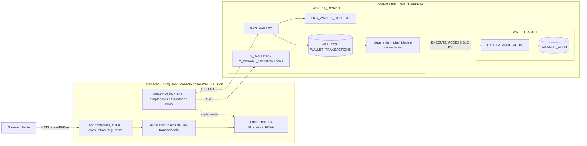
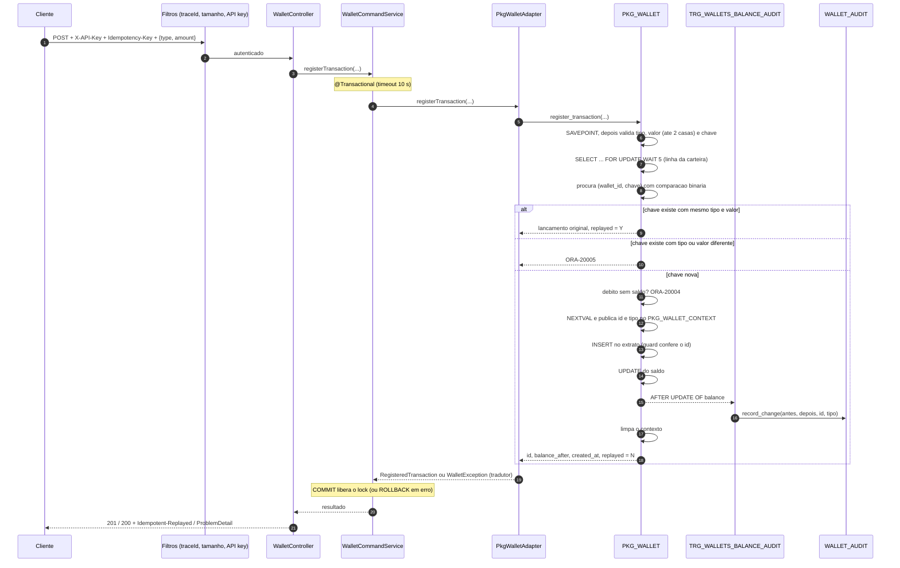
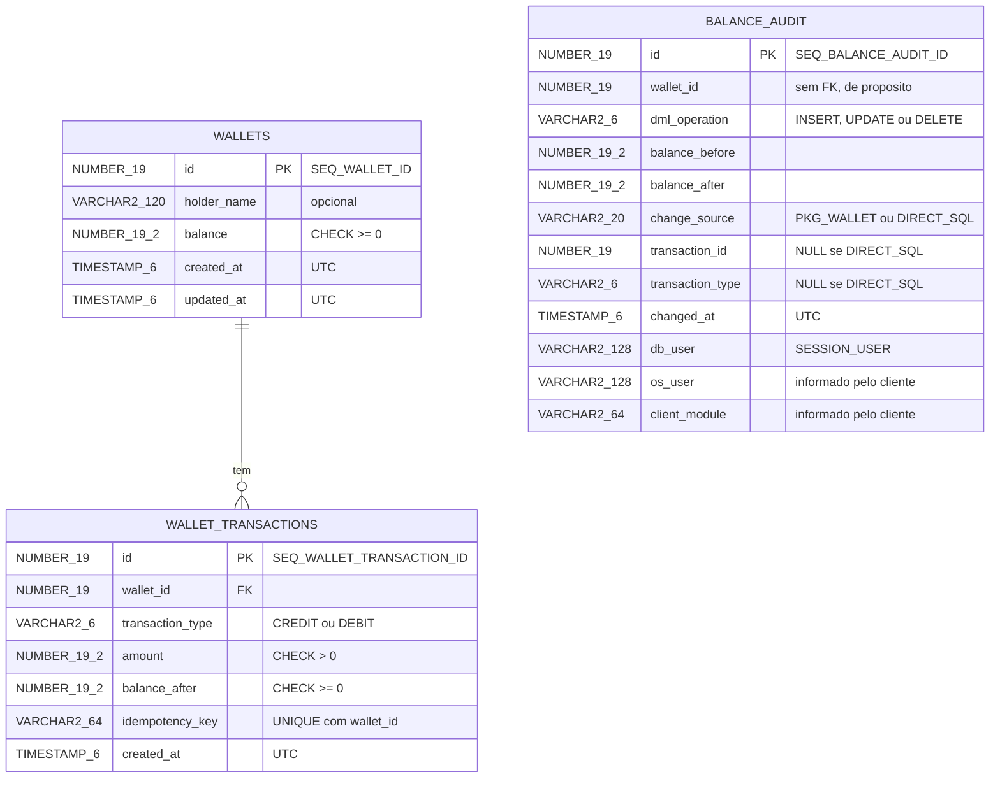
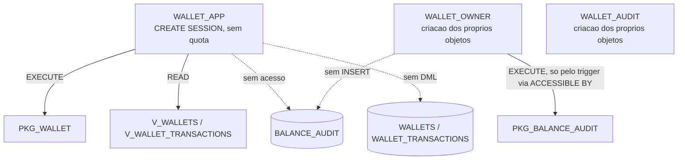

# Arquitetura

## Visao geral

As regras de consistencia (saldo nunca negativo, idempotencia, serializacao por carteira, extrato imutavel, auditoria)
estao no banco. A aplicacao autentica, valida o formato da requisicao, abre uma transacao curta, chama o package e
traduz o resultado para HTTP.

## Camadas da aplicacao

| Pacote | Responsabilidade | Depende de |
|---|---|---|
| `api` | `WalletController`, DTOs, `GlobalExceptionHandler` e `ErrorMapping` (ProblemDetail e status), `api.web` (`TraceIdFilter`, limite de corpo), `api.security` (API key), `OpenApiConfig` | `application`, `domain` |
| `application` | `WalletQueryService` (leitura) e `WalletCommandService` (escrita, `@Transactional` curto) | `domain` |
| `domain` | `Wallet`, `WalletTransaction`, `TransactionType`, `RegisteredTransaction`, `Period`, `PageRequest`, `PageResult`, `ErrorCode` + `WalletException`, portas `WalletQueryPort` e `WalletCommandPort` | nada (sem Spring nem JDBC) |
| `infrastructure.oracle` | `OracleWalletQueryAdapter` (JdbcClient nas views), `PkgWalletAdapter` (CallableStatement no package), `OracleErrorTranslator` | `domain`, Spring JDBC |

Filtros, na ordem em que rodam:

1. `TraceIdFilter`: gera ou reaproveita o `X-Trace-Id` e o coloca no MDC.
2. `RequestSizeLimitFilter`: recusa corpo acima de 16 KB com 413.
3. Cadeia do Spring Security com `ApiKeyAuthenticationFilter`: 401 se a chave estiver ausente ou errada.

Os dois que recusam requisicoes (413 e 401) escrevem o erro no mesmo formato ProblemDetail do `GlobalExceptionHandler`.

## Fluxo de `POST /wallets/{id}/transactions`

## Modelo de dados

`BALANCE_AUDIT` fica em outro schema e nao tem FK para `WALLETS`: a trilha nao depende do schema auditado.

Indices: PK em todas as tabelas; `UNIQUE (wallet_id, idempotency_key)`, que tambem atende a FK; `(wallet_id, created_at,
id)` para o extrato; `(wallet_id, changed_at, id)` na auditoria.

## Objetos de banco

| Objeto | Schema | Criado em |
|---|---|---|
| `WALLET_OWNER`, `WALLET_APP`, `WALLET_AUDIT` (usuarios, quotas, privilegios de sistema) | - | `db/init/01-create-users.sh` |
| `BALANCE_AUDIT`, `SEQ_BALANCE_AUDIT_ID` | audit | `db/migration/audit/V1` |
| `PKG_BALANCE_AUDIT`, `TRG_BALANCE_AUDIT_IMMUTABLE`, `TRG_BALANCE_AUDIT_NO_TRUNCATE`, grant ao owner | audit | `db/migration/audit/V2` |
| `WALLETS`, `SEQ_WALLET_ID` | owner | `db/migration/owner/V1` |
| `WALLET_TRANSACTIONS`, `SEQ_WALLET_TRANSACTION_ID`, indice do extrato | owner | `db/migration/owner/V2` |
| `V_WALLETS`, `V_WALLET_TRANSACTIONS` + `READ` ao app | owner | `db/migration/owner/V3` |
| `PKG_WALLET_CONTEXT` | owner | `db/migration/owner/V4` (spec ampliada em `V6`) |
| `PKG_WALLET` + `EXECUTE` ao app | owner | `db/migration/owner/V5` |
| `TRG_WALLET_TX_IMMUTABLE`, `TRG_WALLET_TX_INSERT_GUARD`, `TRG_WALLETS_ID_IMMUTABLE`, `TRG_WALLET_TABLES_NO_TRUNCATE` | owner | `db/migration/owner/V6` |
| `TRG_WALLETS_BALANCE_AUDIT` | owner | `db/migration/owner/V7` |

## Privilegios

Nada e concedido a `PUBLIC`, inclusive o `INHERIT PRIVILEGES` que o Oracle concede por padrao, revogado no init.
Detalhes e motivos em [DECISIONS.md](../DECISIONS.md), decisao 10.
