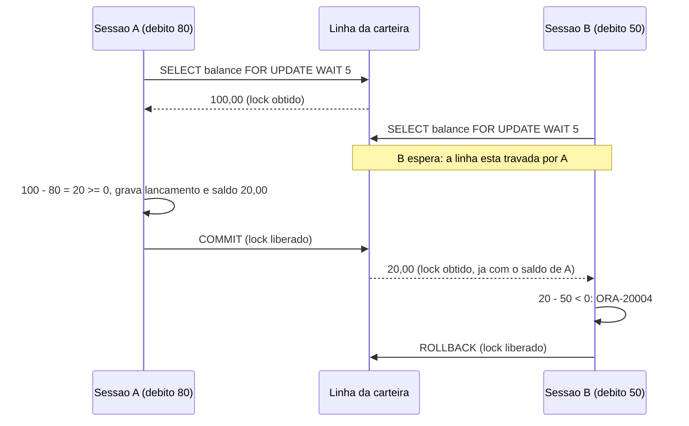
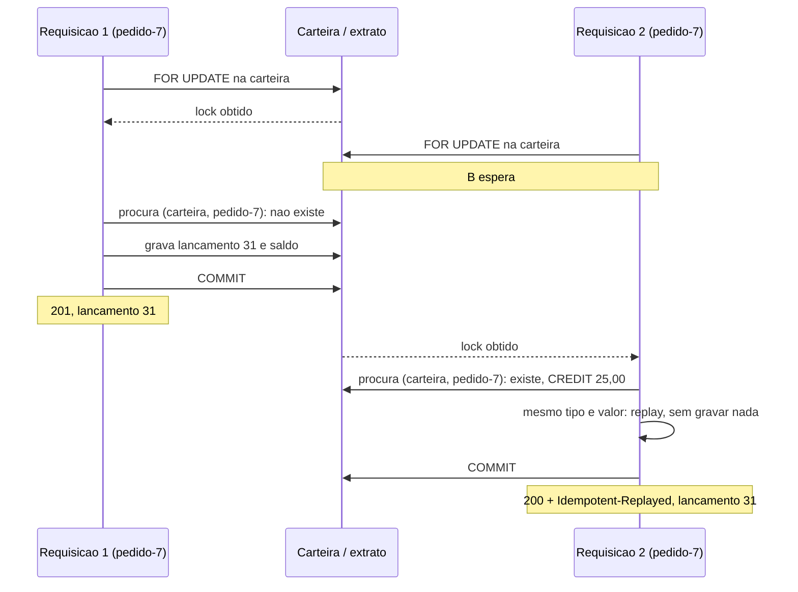

# Concorrencia e idempotencia, passo a passo

Este documento mostra, com linhas do tempo, o que acontece quando operacoes chegam ao mesmo tempo na mesma carteira.
O mecanismo esta todo no `PKG_WALLET` (`db/migration/owner/V5__create_pkg_wallet.sql`); o motivo de cada escolha esta
em [DECISIONS.md](../DECISIONS.md), decisoes 2 a 5.

## O mecanismo em uma frase

Toda decisao sobre uma carteira (aceitar o debito, aplicar ou devolver replay) e tomada com a linha dela travada por
`SELECT ... FOR UPDATE WAIT 5`, e o lock so e liberado no commit da aplicacao.

## Caso 1: dois debitos que, juntos, deixariam o saldo negativo

Saldo inicial: 100,00. A sessao A debita 80,00; a sessao B, ao mesmo tempo, debita 50,00.

Sem o lock, B leria 100,00 (leitura consistente, antes do commit de A), calcularia 50,00 e gravaria esse valor por cima
dos 20,00 de A. Nenhum erro acontece: o `CHECK (balance >= 0)` nao ajuda, porque 50,00 e um saldo valido. O resultado
e uma perda de atualizacao: dois debitos aceitos, mas so um descontado.

O teste `ApiConcurrencyIT` foi executado contra uma versao do package sem o `FOR UPDATE`. Nas tres rodadas, somando as
operacoes que a API respondeu como aplicadas, o saldo final deveria ser -45,00 (o que ja e impossivel); o saldo real
ficou em 10,00, 15,00 e 45,00. O teste falhou nas tres.

## Caso 2: a mesma operacao chegando duas vezes ao mesmo tempo

O cliente manda um credito de 25,00 com `Idempotency-Key: pedido-7`, nao recebe resposta (timeout) e repete. As duas
requisicoes chegam juntas.

Por que a busca precisa vir **depois** do lock: se B procurasse a chave antes de travar a carteira, nao encontraria nada
(A ainda nao comitou) e tentaria gravar tambem. A `UNIQUE (wallet_id, idempotency_key)` seguraria o segundo `INSERT`,
mas com um erro de constraint em vez do replay que o cliente espera.

Por que a busca vem **antes** da checagem de saldo: um retry tardio de um debito ja aplicado, chegando quando o saldo ja
caiu, precisa ser replay. Na ordem inversa, ele receberia "saldo insuficiente", o cliente acharia que a operacao falhou e
repetiria com outra chave.

## Caso 3: mesma chave, operacao diferente

`pedido-7` ja foi usado para um credito de 25,00. Chega `pedido-7` com credito de 26,00 (ou debito de 25,00).

1. A carteira e travada.
2. A chave existe, mas o tipo ou o valor diferem.
3. O package devolve `ORA-20005` e a API responde `409 IDEMPOTENCY_KEY_CONFLICT`. O saldo nao muda.

`25` e `25.00` sao o mesmo valor (comparacao numerica); `10.005` nunca chega a ser comparado, porque o package recusa
valor com mais de duas casas antes da busca.

## Caso 4: o lock demora demais

Uma sessao segura a carteira por mais de 5 s (por exemplo, uma transacao que alguem esqueceu aberta num cliente SQL).

1. A requisicao seguinte espera 5 s no `FOR UPDATE WAIT 5`.
2. O Oracle desiste com `ORA-00054` (no 23ai; `ORA-30006` em versoes anteriores).
3. O package traduz para `ORA-20007`, e a API responde `503 WALLET_LOCKED` com `Retry-After: 1`.
4. O cliente repete **com a mesma chave**. Se a primeira tentativa tivesse sido aplicada, o retry vira replay; se nao,
   e aplicado agora. Nao ha como aplicar duas vezes.

O teste `lockedWalletAnswers503AndTheRetryWithTheSameKeyIsAReplay` reproduz isso: segura o lock por JDBC, recebe o 503,
faz o commit e confere que o retry e replay.

## Caso 5: carteiras diferentes

O lock e na linha da carteira. Operacoes em carteiras diferentes nao disputam nada entre si e rodam em paralelo.

A unica coisa compartilhada e o pool de conexoes da aplicacao. Se muitas requisicoes ficarem esperando o lock de uma
carteira muito disputada, elas ocupam conexoes. Para nao deixar as outras carteiras esperando indefinidamente, quem nao
consegue conexao em 5 s recebe `503 SERVICE_BUSY` com `Retry-After`.

## O que garante a atomicidade

O lancamento e o saldo sao gravados na mesma transacao. Se qualquer passo falhar depois do `INSERT` (o `UPDATE`, o
trigger de auditoria), o package volta ao savepoint marcado no inicio da chamada antes de propagar o erro. Por isso nao
sobra lancamento sem o saldo correspondente, nem quando o chamador captura a excecao e comita. A linha de auditoria
tambem esta na mesma transacao: se a operacao for desfeita, ela tambem e.

## Como isso e provado

| Teste | O que faz |
|---|---|
| `PkgWalletConcurrencyIT` | 16 sessoes, 70 operacoes na mesma carteira direto no package, 5 rodadas |
| `ApiConcurrencyIT` | 16 clientes HTTP reais, 62 operacoes, 12 copias da mesma chave disparadas junto com as demais, retry em 503, 3 rodadas |
| `PkgWalletIT` | espera pelo lock, timeout com `-20007`, atomicidade com erro engolido pelo chamador, comparacao binaria da chave |

Os dois testes de concorrencia verificam:

- o saldo final e a soma do que foi aplicado;
- refazendo o extrato lancamento a lancamento (pela ordem dos ids, que crescem dentro do lock), cada `balance_after` bate
  e nenhum fica negativo;
- a chave repetida e aplicada uma unica vez, e todas as chamadas com ela devolvem o mesmo lancamento;
- a trilha de auditoria conta a mesma historia, linha a linha.

O `ApiConcurrencyIT` verifica, alem disso:

- todas as respostas da chave repetida tem exatamente o mesmo corpo, e so a primeira e `201`;
- cada resposta `200`/`201` e igual ao lancamento gravado no extrato;
- o header `Idempotent-Replayed` aparece se, e somente se, a resposta e replay;
- o retry tardio de um debito ja aplicado, com o saldo zerado, continua sendo replay.
